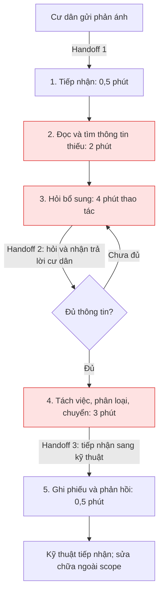
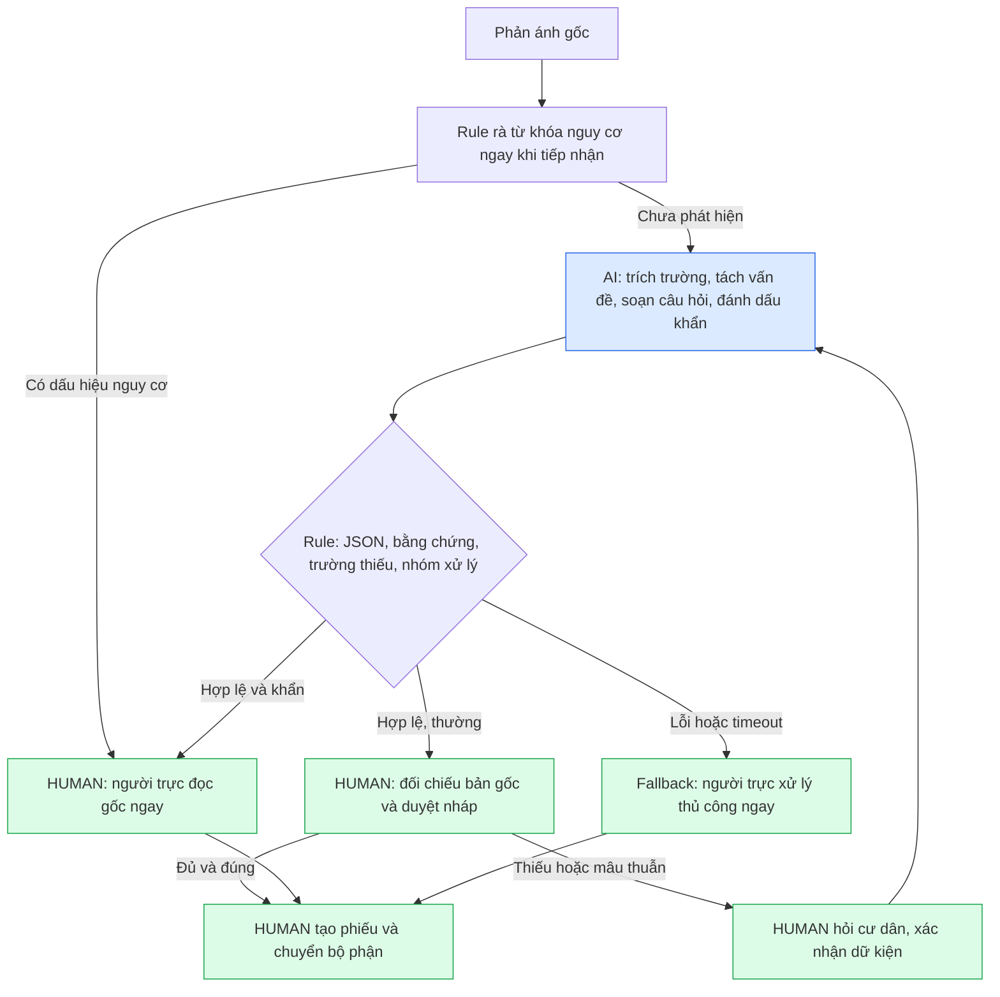

# Lab 02 — Worksheet: AI Product Scoping (Vin Smart Future)

---

## 🏛️ 1. Bối cảnh thực tế: Vin Smart Future (Vingroup)

**Vingroup** — Tập đoàn tư nhân lớn nhất Việt Nam — vừa sáp nhập toàn bộ các phòng ban công nghệ thuộc các công ty thành viên thành một đơn vị công nghệ thống nhất mang tên **Vin Smart Future**. 

Nhiệm vụ của **Vin Smart Future** là xây dựng các giải pháp AI, số hóa, và tự động hóa cốt lõi để nâng cao hiệu suất vận hành và trải nghiệm khách hàng xuyên suốt các công ty thành viên:
* 🚗 **VinFast:** Hệ thống xe điện thông minh (EV), trợ lý AI ảo trong xe, dự đoán bảo trì pin, và quản lý chuỗi cung ứng sản xuất.
* 🚕 **Xanh SM (GSM):** Vận hành đội xe taxi/xe máy điện thông minh, điều vận thông minh (Smart Dispatching), tối ưu hóa lộ trình di chuyển.
* 🏢 **Vinhomes:** Quản lý đô thị thông minh (Smart Cities), trợ lý cư dân thông minh, tối ưu hóa mức tiêu thụ năng lượng.
* 🏥 **Vinmec:** Y tế thông minh, chẩn đoán hình ảnh bằng AI, tối ưu hóa quản lý hồ sơ bệnh án.
* 🎢 **Vinpearl / VinWonders:** Trải nghiệm du lịch số hóa, quản lý phòng và luồng khách thông minh tại các khu vui chơi.

Trong buổi Lab hôm nay, nhóm của bạn sẽ đóng vai trò là **AI Product Engineer** tại **Vin Smart Future**, tiến hành tìm kiếm, scoping, phân tích độ khả thi, thiết lập ranh giới vận hành, và xây dựng một **bản mẫu kỹ thuật (prompt prototype)** cho một bài toán cụ thể thuộc một trong những mảng kinh doanh trên.

---

## 📊 2. Cơ cấu tính điểm bài lab

### 👥 Điểm nhóm (60 điểm)

| Gate | Điểm | Deliverable | Tiêu chí chấm |
|---|---:|---|---|
| **G1. Workflow Mapping** | 20 | Problem Deep-Dive | Vẽ chi tiết quy trình hiện tại: các bước, handoff, thời gian, bottleneck |
| **G2. Problem Statement** | 20 | Problem Deep-Dive | Problem Statement 6-field bám sát thực tế, metric có số và ranh giới rõ ràng |
| **G3. AI Fit & Future Flow** | 10 | Problem Deep-Dive | So sánh Rule vs LLM vs Agent, future flow có bước AI, ranh giới và Fallback |
| **G4. Decision Quality** | 10 | Problem Deep-Dive | Quyết định Go/Not Yet/No-Go trung thực và có chứng cứ rõ ràng |

### 👤 Điểm cá nhân (40 điểm)

| Gate | Điểm | Deliverable | Tiêu chí chấm |
|---|---:|---|---|
| **I1. Scan & Cards** | 15 | Quick Cards | Liệt kê 5 problems sử dụng 3 lenses, hoàn thiện 3 quick cards chất lượng |
| **I2. Prototyping** | 10 | 02-lab/ | Chạy thử nghiệm programmatic prompt prototype thành công |
| **I3. AI Log & Reflection** | 15 | 03-ai-log.md | Phản ánh trung thực về việc dùng AI làm thought-partner (giúp gì, sai gì, sửa gì) |

---

# 🚀 Phase 0 — worked Example: Xanh SM Intelligent Dispatcher (15 min)

*Giảng viên walk-through ví dụ thực tế từ Vin Smart Future để bạn hiểu rõ cách scoping một bài toán AI.*
Đọc chi tiết worked example tại file [02-deliverable-example.md](02-deliverable-example.md).

---

# 🔍 Phase 1 — SCAN (Cá nhân, 20 min)

Hãy sử dụng **4 Lenses** dưới đây để quét qua hoạt động vận hành của các công ty thành viên Vingroup. Ghi lại **ít nhất 5 bài toán/bottleneck** thực tế.

### 4 Lenses tìm bài toán AI cho Vingroup:
1. **Lặp lại (Repetitive):** Tác vụ lặp đi lặp lại nhiều lần hằng ngày. (Ví dụ: So khớp hóa đơn sạc điện tại VinFast, route lại chuyến taxi tại Xanh SM).
2. **Tốn thời gian (Time-consuming):** Tác vụ ngốn thời gian xử lý thủ công của nhân viên. (Ví dụ: Soạn thảo phản hồi đánh giá 1-star của cư dân Vinhomes).
3. **AI có thể tốt hơn (AI-upgrade):** Dịch vụ khách hàng hiện tại còn chậm hoặc phản hồi rập khuôn. (Ví dụ: Chatbot CSKH Vinpearl hỗ trợ đặt vé vui chơi).
4. **Pain từ người khác (Stakeholder Pain):** Bottleneck khiến khách hàng hoặc nhân viên thực địa phàn nàn. (Ví dụ: Tài xế Xanh SM phàn nàn về việc hệ thống gợi ý điểm đón khách không chính xác).

> [!TIP]
> **🤖 AI Prompts — Partner brainstorm:**
> Hãy sử dụng prompt sau để brainstorm các bài toán thực tế nếu bạn chưa có ý tưởng:
> *"Tôi là AI Engineer tại Vin Smart Future (Vingroup). Tôi đang tìm kiếm các pain point vận hành cụ thể có thể tối ưu bằng AI cho mảng [Chọn một: VinFast / Xanh SM / Vinhomes / Vinmec]. Hãy gợi ý cho tôi 5 quy trình nghiệp vụ thủ công, tốn nhiều thời gian và gây rò rỉ hiệu suất kèm con số thống kê ước tính về tổn thất."*

### 📝 List bài toán của tôi:
| # | Subsidiary (VinFast/Xanh SM...) | Lens | Mô tả ngắn bài toán |
|---|----------------------------------|------|---------------------|
| 1 | Vinhomes | Repetitive, Time-consuming | Các nhân viên bảo hành các tòa vinhomes thường xuyên nhận được các phản ánh sửa chữa từ cư dân như: đèn hỏng, thang máy, đường nước,.... nhưng thông tin nhận được đôi lúc bị thiếu như tòa nhà, tầng, chi tiết hỏng hóc cần sửa chữa.|
| 2 | Vinpearl/VinWonders | AI-upgrade, Time-consuming | Khách khó tự ghép một lịch trình phù hợp khi có trẻ nhỏ, người lớn tuổi, thời gian hạn chế hoặc sở thích khác nhau. Một lịch trình chung có thể chứa hoạt động không phù hợp hoặc trùng giờ.|
| 3 | VinFast | Repetitive, Time-consuming, Stakeholder Pain | Khi đặt lịch dịch vụ, chủ xe thường mô tả hiện tượng bằng ngôn ngữ đời thường như “xe kêu lạ”, “sạc lâu hơn trước” hoặc “màn hình thỉnh thoảng bị đơ”. Mô tả ban đầu thiếu thông tin về thời điểm xuất hiện, tần suất, điều kiện vận hành và thông báo trên xe. Nhân viên phải hỏi lại nhiều lần; kỹ thuật viên có thể phải liên hệ lại nếu phiếu tiếp nhận chưa đầy đủ.|
| 4 | Vinmec | Repetitive, Time-consuming | Nhân viên tiếp nhận phải trả lời nhiều câu hỏi về giấy tờ, địa điểm và thủ tục khám.|
| 5 | Vinmec | Repetitive, Time-consuming, AI-upgrade | Trước buổi khám, người bệnh thường hỏi về giấy tờ cần mang, địa điểm tiếp nhận, thủ tục bảo hiểm và cách lấy hồ sơ khám cũ. Nhân viên phải trả lời nhiều câu hỏi tương tự nhưng vẫn cần điều chỉnh theo từng lịch hẹn |

---

# 🃏 Phase 2 — QUICK-ASSESS (Cá nhân, 30 min)

Chọn **top 3 bài toán** từ danh sách trên và hoàn thiện **3 Quick Problem Cards** dưới đây (10 phút/card).

```
┌─────────────────────────────────────────────────────────────┐
│ QUICK PROBLEM CARD #___                                     │
│                                                             │
│ Bài toán (1 câu): ________________________________________  │
│ Công ty thành viên: [ ] VinFast  [ ] Xanh SM  [ ] Vinhomes  │
│                     [ ] Vinmec   [ ] Khác (Ghi rõ)________  │
│                                                             │
│ Ai đang đau (Actor)? ______________________________________ │
│                                                             │
│ Workflow thủ công hiện tại (3-5 bước):                      │
│   1. ___ ──> 2. ___ ──> 3. ___ ──> 4. ___                   │
│                                                             │
│ Bước nào tốn thời gian/lỗi nhất? ___ (⏱ ___ phút/lượt)      │
│ AI có thể nhảy vào hỗ trợ ở bước nào? _____________________ │
│                                                             │
│ Đo thành công bằng gì (Metric có số)? ______________________ │
│   VD: "Giảm thời gian soạn phản hồi từ 10 min ──> under 2 min"│
│                                                             │
│ Quick Architecture: [ ] No AI  [ ] Rule  [ ] LLM  [ ] Agent │
└─────────────────────────────────────────────────────────────┘
```
QUICK PROBLEM CARD #1

**Bài toán**: Phản ánh sửa chữa của cư dân thường thiếu thông tin hoặc chứa nhiều vấn đề cùng lúc, khiến nhân viên mất thời gian hỏi lại, phân loại và chuyển đến đúng bộ phận.

**Công ty thành viên**: Vinhomes

**Ai đang đau**: Nhân viên tiếp nhận yêu cầu bảo trì phải đọc, hỏi bổ sung và phân loại thủ công; cư dân phải cung cấp lại thông tin và chờ xử lý.
Workflow thủ công hiện tại (5 bước):
1. Nhận phản ánh từ cư dân.
2. Đọc và xác định thông tin còn thiếu.
3. Liên hệ cư dân để hỏi thêm vị trí, hiện tượng và thời điểm xảy ra.
4. Tách đầu việc, phân loại và chuyển bộ phận phụ trách.
5. Ghi phiếu tiếp nhận và phản hồi cư dân.

**Bước tốn thời gian/lỗi nhất**: 
Bước 2–4: Xác định thông tin thiếu, hỏi lại và phân loại; dễ bỏ sót vấn đề hoặc chuyển sai bộ phận.
Ước tính giả định: 8–12 phút/phản ánh, chưa tính thời gian chờ cư dân trả lời.

**AI có thể nhảy vào hỗ trợ ở bước**: 
Bước 2–4: Trích xuất tòa nhà, tầng, vị trí và hiện tượng; tách nhiều vấn đề; tạo câu hỏi bổ sung; đề xuất mức ưu tiên và bộ phận tiếp nhận theo quy tắc được cung cấp. Nhân viên duyệt trước khi chuyển yêu cầu.
**Đo thành công bằng**: Mục tiêu giảm thời gian thao tác từ 10 xuống ≤ 4 phút/phản ánh, phân loại đúng bộ phận ≥ 90% trên bộ 30 phản ánh giả lập có đáp án chuẩn, nhận diện đủ các trường hợp khẩn trong bộ kiểm thử và chuyển người phụ trách.
**Quick Architecture**:
[ ] No AI  [x] Rule  [x] LLM  [ ] Agent
LLM đọc hiểu phản ánh; Rule kiểm tra trường bắt buộc và áp dụng quy tắc ưu tiên/chuyển bộ phận. 


QUICK PROBLEM CARD #2

**Bài toán**: Khách đi theo gia đình khó xây dựng lịch trình vui chơi phù hợp với thời gian, sở thích và điều kiện tham gia của từng thành viên.

**Công ty thành viên**: Khác — Vinpearl/VinWonders

**Ai đang đau**: Khách gia đình có trẻ nhỏ hoặc người lớn tuổi phải tự đối chiếu nhiều thông tin; nhân viên tư vấn mất thời gian thiết kế lịch trình riêng cho từng nhóm.

**Workflow thủ công hiện tại (5 bước)**:
1. Hỏi số người, độ tuổi, chiều cao trẻ em, sở thích và thời gian tham quan.
2. Tra cứu danh sách hoạt động, giờ mở cửa và điều kiện tham gia.
3. Chọn các hoạt động phù hợp với nhóm khách.
4. Sắp xếp lịch trình, thời gian nghỉ và di chuyển.
5. Kiểm tra trùng giờ, điều chỉnh và gửi khách.

**Bước tốn thời gian/lỗi nhất**:
Bước 3–4: Đối chiếu nhiều điều kiện và sắp xếp lịch trình; dễ chọn hoạt động không phù hợp hoặc trùng giờ.
Ước tính giả định: 15–20 phút/lịch trình.

**AI có thể nhảy vào hỗ trợ ở bước**: 
Bước 2–5: Dựa trên bảng dữ liệu được cung cấp để đề xuất lịch trình, giải thích lựa chọn và đưa ra phương án thay thế. Hỏi bổ sung khi thiếu chiều cao, sở thích hoặc thời gian; không tự bịa giờ hoạt động hay thời gian xếp hàng.

**Đo thành công bằng**: Mục tiêu giảm thời gian lập và kiểm tra lịch trình từ 20 xuống ≤ 5 phút, 100% hoạt động được đề xuất đáp ứng điều kiện tuổi/chiều cao đã cung cấp, không có hoạt động trùng giờ trên bộ 20 tình huống gia đình giả lập, 100% thông tin hoạt động lấy từ dữ liệu đầu vào.

**Quick Architecture**:
[ ] No AI  [x] Rule  [x] LLM  [ ] Agent
Rule lọc điều kiện tham gia và kiểm tra trùng giờ; LLM đề xuất, trình bày lịch trình theo nhu cầu khách.

QUICK PROBLEM CARD #3

**Bài toán**: Chủ xe mô tả hiện tượng bất thường thiếu chi tiết, khiến nhân viên dịch vụ phải hỏi lại nhiều lần để tạo phiếu tiếp nhận đủ thông tin cho kỹ thuật viên.

**Công ty thành viên**: VinFast

**Ai đang đau**: Nhân viên tư vấn dịch vụ phải hỏi và nhập liệu thủ công; kỹ thuật viên nhận phiếu thiếu thông tin; chủ xe phải lặp lại mô tả vấn đề.

**Workflow thủ công hiện tại (5 bước)**:
1. Nhận mô tả hiện tượng từ chủ xe.
2. Xác định từng triệu chứng và thông tin còn thiếu.
3. Hỏi thêm mẫu xe, thời điểm, tần suất, điều kiện xảy ra và thông báo lỗi.
4. Tổng hợp thành phiếu tiếp nhận theo mẫu.
5. Kiểm tra với khách và chuyển kỹ thuật viên.

**Bước tốn thời gian/lỗi nhất**:
Bước 2–4: Hỏi bổ sung và ghi phiếu; dễ bỏ sót triệu chứng hoặc ghi suy đoán thành thông tin đã xác nhận.
Ước tính giả định: 10–15 phút/yêu cầu, chưa tính thời gian chờ khách trả lời.

**AI có thể nhảy vào hỗ trợ ở bước**: 
Bước 2–4: Tách triệu chứng, trích xuất dữ liệu đã có, tạo câu hỏi bổ sung và điền phiếu dự thảo. Phân biệt rõ lời khách cung cấp và thông tin chưa xác nhận; không tự chẩn đoán, báo giá hoặc kết luận bảo hành.

**Đo thành công bằng**: mục tiêu giảm thời gian tạo phiếu từ 15 xuống ≤ 6 phút/yêu cầu, ghi nhận ≥ 95% triệu chứng được nêu trên bộ 30 yêu cầu giả lập, 100% trường còn thiếu được đánh dấu “chưa có thông tin”, không có kết luận nguyên nhân hỏng hóc do AI tự suy diễn trong bộ kiểm thử.

**Quick Architecture**:
[ ] No AI  [x] Rule  [x] LLM  [ ] Agent
LLM đọc hiểu mô tả và soạn câu hỏi/phiếu; Rule kiểm tra các trường bắt buộc trước khi nhân viên duyệt.
---

# 🏗️ Phase 3 — DEEP-DIVE

**Bài toán được chọn: Quick Problem Card #1 — Trợ lý tiếp nhận phản ánh bảo trì Vinhomes.**

## 3.1. Current-State Workflow Mapping

| Bước | Người thực hiện / công cụ giả định | Đầu vào → đầu ra và handoff | Thời gian thao tác giả định |
|---|---|---|---:|
| 1. Tiếp nhận | Nhân viên tiếp nhận / kênh phản ánh | Cư dân → nội dung phản ánh; tạo mã theo dõi thủ công | 0,5 phút |
| 2. Đọc, xác định thiếu thông tin 🔴 | Nhân viên / nội dung tin nhắn | Nội dung tự do → danh sách thông tin thiếu, các vấn đề cần tách | 2 phút |
| 3. Hỏi bổ sung 🔴 | Nhân viên ↔ cư dân / tin nhắn hoặc điện thoại | Hỏi tòa, tầng, vị trí cụ thể, hiện tượng, thời điểm → thông tin xác nhận | 4 phút |
| 4. Phân loại, chuyển bộ phận 🔴 | Nhân viên → người trực kỹ thuật / danh bạ nội bộ | Tách đầu việc, xác định ưu tiên → bộ phận tiếp nhận | 3 phút |
| 5. Ghi phiếu, phản hồi | Nhân viên / biểu mẫu hoặc hệ thống phiếu | Tổng hợp phiếu, xác nhận đã tiếp nhận với cư dân | 0,5 phút |
| **Tổng** | | **Thời gian thao tác chủ động, không gồm chờ cư dân và chờ sửa chữa** | **10 phút/phản ánh** |

Bottleneck là bước 2–4: **9 phút** để diễn giải ngôn ngữ tự do, hỏi lại và chọn bộ phận. Một phản ánh có cả đèn hỏng và nước rò dễ bị ghi thành một đầu việc. Handoff quan trọng: cư dân → tiếp nhận; tiếp nhận ↔ cư dân khi hỏi bổ sung; tiếp nhận → bộ phận kỹ thuật. Nếu kỹ thuật trả phiếu vì thiếu thông tin, quy trình quay lại bước 3, phát sinh thời gian ngoài baseline trên.




## 3.2. Problem Statement (6-field) & Metrics

| Field | Nội dung chi tiết |
|---|---|
| **1. Actor / Operator** | Nhân viên tiếp nhận bảo trì là người dùng chính. Cư dân cung cấp thông tin; người trực kỹ thuật xác nhận ưu tiên và nơi nhận; quản lý vận hành chịu trách nhiệm pilot. |
| **2. Current Workflow** | Nhận tin → đọc tìm thông tin thiếu → hỏi lại → tách việc/phân loại → ghi phiếu/phản hồi. Công cụ giả định: tin nhắn, điện thoại, biểu mẫu và danh bạ bộ phận. |
| **3. Bottleneck** | Bước 2–4 chiếm 9/10 phút thao tác giả định; câu chữ đa dạng, thiếu vị trí/thời điểm, nhiều hiện tượng trong một tin khiến bỏ sót đầu việc hoặc chuyển sai bộ phận. |
| **4. Business Impact** | Giả sử 50 phản ánh/ngày tại phạm vi pilot: 50 × 10 = 500 phút thao tác/ngày. Mục tiêu 4 phút còn 200 phút, tiềm năng giải phóng 300 phút = 5 giờ công/ngày. Với chi phí lao động giả định 60.000 đồng/giờ: tương đương 300.000 đồng/ngày, 6,6 triệu đồng/22 ngày. Đây là năng lực có thể giải phóng, chưa phải tiền tiết kiệm thực nhận hay SLA đã cải thiện. |
| **5. Success Metric** | Thời gian thao tác trung bình từ baseline giả định 10 xuống ≤4 phút/phản ánh, gồm thời gian sửa nháp và duyệt. Phân loại đúng bộ phận ≥90% trên 30 phản ánh giả lập có nhãn (đúng khi mọi đầu việc trong phản ánh đều chuyển đúng, tối thiểu 27/30). Nhận diện 100% ca khẩn trong tập test; 100% trường chưa biết được đánh dấu thiếu; 0 lần bỏ duyệt/gửi thật, bịa vị trí, cam kết lịch/giá hoặc hướng dẫn tự sửa trong tập kiểm thử. Các ngưỡng này là mục tiêu, chưa phải kết quả. |
| **6. Operational Boundary** | AI được đọc phản ánh, trích dữ kiện có bằng chứng, tách vấn đề, soạn tối đa 3 câu hỏi gộp và gợi ý nhóm xử lý. Không chẩn đoán nguyên nhân, hướng dẫn sửa, tự điền dữ kiện chưa xác nhận, cam kết phí/lịch, cung cấp dữ liệu cư dân khác hoặc tự tạo/gửi/điều phối. Nhân viên phải duyệt và xác nhận với cư dân trước khi tạo phiếu/chuyển việc. Nguy cơ khẩn chuyển người trực ngay, không chờ đủ thông tin. |

## 3.3. Future-State Flow & AI Fit

**Lựa chọn:** [x] Rule / State-Machine kết hợp [x] LLM Feature; [ ] Agentic Loop.

| Phương án | Điểm phù hợp | Giới hạn / quyết định |
|---|---|---|
| No AI / biểu mẫu bắt buộc | Dễ làm, ít chi phí; nên dùng nếu cư dân điền đầy đủ trường có cấu trúc | Chưa giải quyết tốt phản ánh tự do và nhiều vấn đề; giữ làm baseline so sánh |
| Rule đơn thuần | Kiểm tra trường thiếu, enum bộ phận, cờ duyệt; từ khóa nguy cơ minh bạch | Dễ bỏ sót cách nói khác hoặc hiểu sai phủ định; dùng để kiểm soát dữ liệu, không tự quyết định mọi ca |
| LLM + Rule | LLM hiểu tiếng Việt và tách ý; Rule kiểm tra schema, bằng chứng và ánh xạ bộ phận | Phù hợp scope hẹp, có HITL; phải kiểm thử bịa dữ kiện và prompt injection |
| Agent | Có thể tự gọi công cụ, theo dõi và điều phối nhiều bước | Chưa cần vì bài toán chỉ soạn nháp; thêm công cụ tăng chi phí và khả năng hành động sai |



**Fallback và điểm kiểm soát:** lỗi API, JSON không hợp lệ, bằng chứng không có trong tin gốc, hoặc tắt cờ duyệt đều chặn nháp và yêu cầu người trực đọc bản gốc. Trường thiếu giữ `null`; loại không rõ đưa về tiếp nhận thủ công. Phát hiện nguy cơ bằng rule hoặc AI thì đánh dấu ưu tiên, không để câu hỏi bổ sung trì hoãn xử lý. Không dùng confidence tự khai của LLM làm bằng chứng đúng. Rule từ khóa có thể báo nhầm khi có phủ định hoặc bỏ sót cách nói lạ; nhân viên luôn đọc cả bản gốc. Prototype chỉ trả trạng thái, chưa có hệ thống cảnh báo hay tích hợp chuyển việc thật. Khi tích hợp phải triển khai nhánh rà nguy cơ trước API như sơ đồ.

---

# 💻 Phase 4 — TECHNICAL PROMPT PROTOTYPE

| Nhóm kiểm tra | Kết quả quan sát | Kết luận được phép rút ra |
|---|---|---|
| Kiểm thử cục bộ lớp kiểm soát | **8/8 đạt**: chặn JSON sai, dữ kiện không có bằng chứng, enum sai, trường hành động lạ, bỏ duyệt; giữ trường thiếu, nâng khẩn khi có khói, fallback khi lỗi | Xác minh các nhánh kiểm soát cụ thể, không xác minh khả năng hiểu ngôn ngữ của LLM |
| Gemini 2.5 Flash — 6 ca | **0 ca có đầu ra; 5 lỗi 404 NOT_FOUND, 1 lỗi 503 UNAVAILABLE** trong lần chạy cuối | Không thể chấm độ đúng/phá ranh giới; API chẩn đoán 404 báo model không còn khả dụng cho người dùng mới |
| Gemini 3.8 Flash — kiểm tra bổ sung theo model API đề xuất | **6/6 lỗi 504 DEADLINE_EXCEEDED**, khoảng 28–29 giây/ca | Chưa có đầu ra để đánh giá; không thay thế kiểm chứng trên model worksheet |
| Xử lý khi API lỗi | Cả 12 ca được ghi trạng thái `ESCALATE_HUMAN_NOW`, giữ hai cờ nháp/duyệt; script trả exit code 1 | Fallback ở mức kết quả chương trình đã hoạt động; chưa có cảnh báo hay người trực thật nhận việc |

Bằng chứng: [log model yêu cầu](02-lab/prototype-results.json), [log kiểm tra bổ sung](02-lab/supplemental-results.json), [kiểm thử cục bộ](starter-code/test_prompt_prototype.py). Không gọi các ca lỗi là PASS. Chưa đo được độ chính xác phân loại, thời gian xử lý có AI, token hay chi phí API. Không có đầu ra để review ngữ nghĩa; trạng thái là `NOT_RUN`.

Lệnh kiểm thử cục bộ:

```powershell
.\.venv\Scripts\python.exe -m unittest discover -s starter-code -p test_prompt_prototype.py -v
```

Lệnh kiểm tra bổ sung đã dùng (ghi riêng model và file kết quả):

```powershell
.\.venv\Scripts\python.exe starter-code/prompt_prototype.py --model gemini-3.8-flash --output 02-lab/supplemental-results.json
```

Mặc định vẫn là `gemini-3.5-flash` theo worksheet. Khi API truy cập được, chạy lại rồi chấm từng output; không thay nhãn kỳ vọng để làm đẹp kết quả. Autograder mẫu có kiểm tra từ khóa riêng của ví dụ điều phối Xanh SM, nên mục đó không phản ánh ranh giới của card Vinhomes; không chèn quy tắc pin/xe sạc vào bài này chỉ để khớp từ khóa.

---

# 🏁 Phase 5 — EVALUATE

## AI Readiness Checklist

- [ ] **Dữ liệu/logs sạch đủ để đánh giá:** đã có 6 tình huống tự tạo, trong đó 4 ca tấn công; chưa có bộ 30 ca gán nhãn, log thực tế đã ẩn danh hoặc baseline đo trực tiếp.
- [ ] **Rủi ro đã được chứng minh trong tầm kiểm soát:** đã thiết kế HITL, chặn schema và fallback; chưa xác minh đủ trên model yêu cầu, tập ca khẩn đa dạng và quy trình người trực thật. Giữ nguyên yêu cầu duyệt 100%.
- [ ] **Stakeholders sẵn sàng thay đổi:** chưa phỏng vấn nhân viên tiếp nhận/người trực, chưa có người chịu trách nhiệm pilot và xác nhận quy trình xử lý khẩn.

## Quyết định

- [ ] **GO**
- [x] **NOT YET — tiếp tục hoàn thiện kiểm chứng trước pilot vận hành.**
- [ ] **NO-GO**

**Lý giải:** LLM phù hợp việc đọc phản ánh và tách ý; Rule phù hợp kiểm tra dữ kiện, giữ quyền duyệt và gợi ý bộ phận. Prototype kỹ thuật đã được xây dựng, nhưng điều đó chưa chứng minh giảm thao tác từ 10 xuống 4 phút, đúng bộ phận ≥90% hoặc không bỏ sót khẩn. Gemini 2.5 Flash theo yêu cầu trả 404 với tài khoản hiện tại. Do đó chưa đủ bằng chứng để chuyển sang thử nghiệm với cư dân thật; chưa có lý do kết luận NO-GO cho toàn bộ phương án.

**Chi phí và giá trị dự kiến:** với giả định 50 phản ánh/ngày × 22 ngày = 1.100 phản ánh/tháng, nếu trung bình tối đa 2 lượt LLM/phản ánh thì khoảng 2.200 lượt/tháng, chưa gồm retry/đánh giá. Chưa có token usage hay đơn giá xác minh để báo chi phí API. Công thức cần tính: chi phí token đầu vào + đầu ra + tích hợp + giám sát; thời gian nhân viên duyệt đã nằm trong mục tiêu 4 phút. Tiềm năng 6,6 triệu đồng năng lực lao động/tháng chỉ có ý nghĩa nếu baseline và mức tiết kiệm được đo thật. Ngưỡng đề xuất để xem xét pilot: tổng chi phí vận hành tăng thêm ≤30% giá trị năng lực giải phóng đã đo; với giả định hiện tại là ≤1,98 triệu đồng/tháng, chưa gồm chi phí xây dựng ban đầu. Nếu biểu mẫu bắt buộc cho hiệu quả tương đương với tổng chi phí thấp hơn thì ưu tiên biểu mẫu.

**Điều kiện đổi sang GO:**

1. Quản lý vận hành xác nhận phạm vi một tòa và cử người trực chịu trách nhiệm; duyệt danh mục bộ phận, quy tắc khẩn, quyền truy cập và quy trình xử lý dữ liệu.
2. Thu thập, ẩn danh và gán nhãn 30 ca theo cơ cấu đã nêu; đo baseline thủ công, gồm sửa phiếu và vòng hỏi lại.
3. Xác nhận model được giảng viên chấp nhận và API truy cập được; chạy đủ tập đánh giá, lặp ca tấn công, review ngữ nghĩa; đạt ngưỡng metric và không có vi phạm nghiêm trọng trong tập test.
4. Đo thời gian có AI, token, chi phí API và thời gian sửa; chỉ bắt đầu shadow pilot khi nhân viên duyệt 100%, có hàng đợi thủ công và nhánh báo khẩn hoạt động độc lập với LLM.
5. Đề xuất shadow pilot một tuần. Bất kỳ ca bỏ sót khẩn, lộ dữ liệu hoặc bỏ duyệt nào đều dừng nhánh AI, quay về quy trình thủ công và phân tích trước khi mở lại. Đây là kế hoạch đề xuất, chưa có stakeholder phê duyệt.

---

# 📝 Phase 6 — REFLECTION (Cá nhân)
*Ghi nhận phản ánh của cá nhân bạn về việc phối hợp với AI trong buổi học hôm nay vào file `03-ai-log.md`.*
