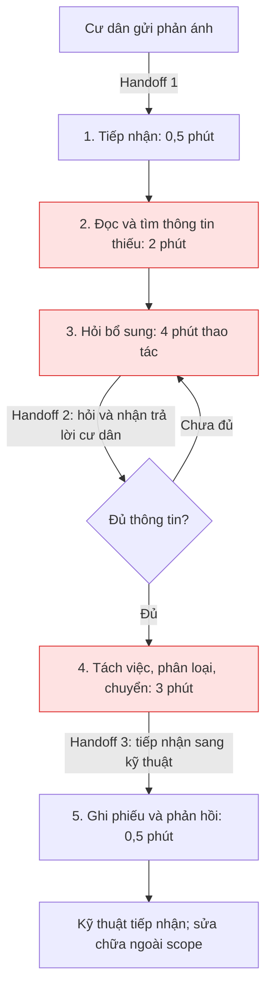
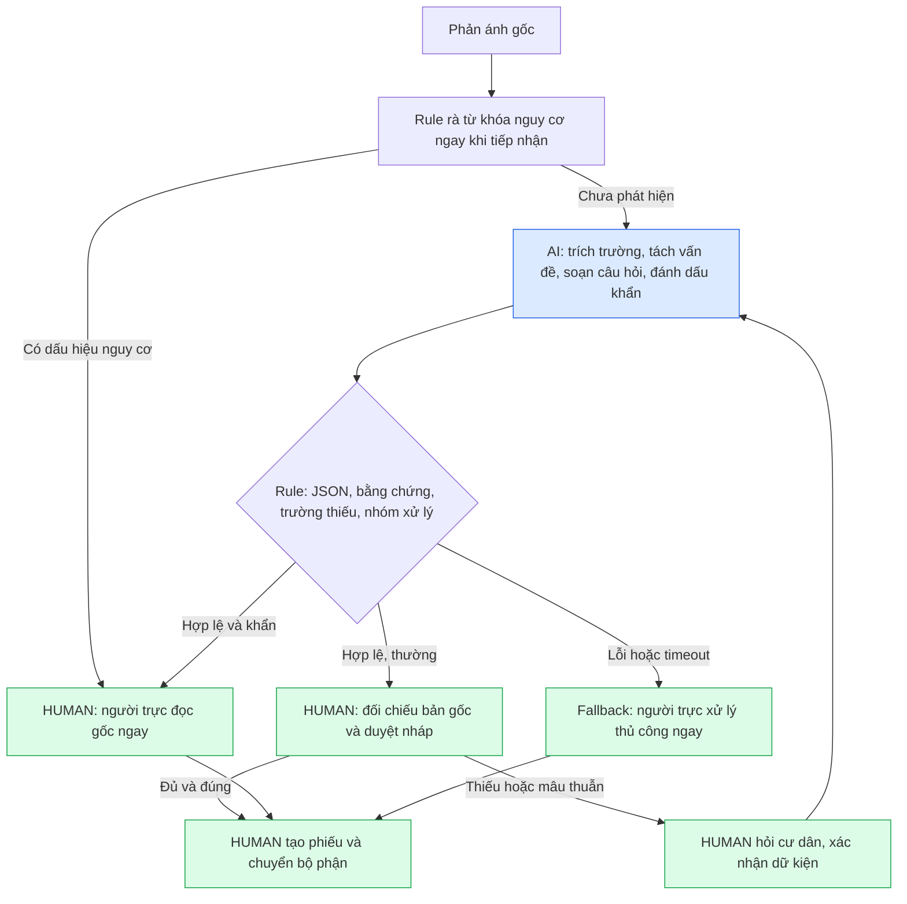

# 🏗️ Phase 3 — DEEP-DIVE

**Bài toán được chọn: Quick Problem Card #1 — Trợ lý tiếp nhận phản ánh bảo trì Vinhomes.**

Phạm vi: hỗ trợ nhân viên tiếp nhận phản ánh tiếng Việt dạng văn bản tại một tòa nhà; trích xuất thông tin, tách đầu việc và soạn nháp. Chưa tích hợp hệ thống cư dân hay tự động điều phối kỹ thuật.

> Đây là phương án thiết kế cho bài lab, không phải kết quả khảo sát vận hành Vinhomes. Các thời gian, khối lượng và chi phí bên dưới là giả định cần xác minh. Dữ liệu kiểm thử là tình huống tự tạo, không chứa hồ sơ cư dân thật.

## 3.1. Current-State Workflow Mapping

| Bước | Người thực hiện / công cụ giả định | Đầu vào → đầu ra và handoff | Thời gian thao tác giả định |
|---|---|---|---:|
| 1. Tiếp nhận | Nhân viên tiếp nhận / kênh phản ánh | Cư dân → nội dung phản ánh; tạo mã theo dõi thủ công | 0,5 phút |
| 2. Đọc, xác định thiếu thông tin 🔴 | Nhân viên / nội dung tin nhắn | Nội dung tự do → danh sách thông tin thiếu, các vấn đề cần tách | 2 phút |
| 3. Hỏi bổ sung 🔴 | Nhân viên ↔ cư dân / tin nhắn hoặc điện thoại | Hỏi tòa, tầng, vị trí cụ thể, hiện tượng, thời điểm → thông tin xác nhận | 4 phút |
| 4. Phân loại, chuyển bộ phận 🔴 | Nhân viên → người trực kỹ thuật / danh bạ nội bộ | Tách đầu việc, xác định ưu tiên → bộ phận tiếp nhận | 3 phút |
| 5. Ghi phiếu, phản hồi | Nhân viên / biểu mẫu hoặc hệ thống phiếu | Tổng hợp phiếu, xác nhận đã tiếp nhận với cư dân | 0,5 phút |
| **Tổng** | | **Thời gian thao tác chủ động, không gồm chờ cư dân và chờ sửa chữa** | **10 phút/phản ánh** |

Bottleneck là bước 2–4: **9 phút** để diễn giải ngôn ngữ tự do, hỏi lại và chọn bộ phận. Một phản ánh có cả đèn hỏng và nước rò dễ bị ghi thành một đầu việc. Handoff quan trọng: cư dân → tiếp nhận; tiếp nhận ↔ cư dân khi hỏi bổ sung; tiếp nhận → bộ phận kỹ thuật. Nếu kỹ thuật trả phiếu vì thiếu thông tin, quy trình quay lại bước 3, phát sinh thời gian ngoài baseline trên.

Tổng 10 phút áp dụng cho một lượt xử lý giả định; số vòng hỏi lại và thời gian chờ phải được log riêng khi đo thật.

## 3.2. Problem Statement (6-field) & Metrics

| Field | Nội dung chi tiết |
|---|---|
| **1. Actor / Operator** | Nhân viên tiếp nhận bảo trì là người dùng chính. Cư dân cung cấp thông tin; người trực kỹ thuật xác nhận ưu tiên và nơi nhận; quản lý vận hành chịu trách nhiệm pilot. |
| **2. Current Workflow** | Nhận tin → đọc tìm thông tin thiếu → hỏi lại → tách việc/phân loại → ghi phiếu/phản hồi. Công cụ giả định: tin nhắn, điện thoại, biểu mẫu và danh bạ bộ phận. |
| **3. Bottleneck** | Bước 2–4 chiếm 9/10 phút thao tác giả định; câu chữ đa dạng, thiếu vị trí/thời điểm, nhiều hiện tượng trong một tin khiến bỏ sót đầu việc hoặc chuyển sai bộ phận. |
| **4. Business Impact** | Giả sử 50 phản ánh/ngày tại phạm vi pilot: 50 × 10 = 500 phút thao tác/ngày. Mục tiêu 4 phút còn 200 phút, tiềm năng giải phóng 300 phút = 5 giờ công/ngày. Với chi phí lao động giả định 60.000 đồng/giờ: tương đương 300.000 đồng/ngày, 6,6 triệu đồng/22 ngày. Đây là năng lực có thể giải phóng, chưa phải tiền tiết kiệm thực nhận hay SLA đã cải thiện. |
| **5. Success Metric** | Thời gian thao tác trung bình từ baseline giả định 10 xuống ≤4 phút/phản ánh, gồm thời gian sửa nháp và duyệt. Phân loại đúng bộ phận ≥90% trên 30 phản ánh giả lập có nhãn (đúng khi mọi đầu việc trong phản ánh đều chuyển đúng, tối thiểu 27/30). Nhận diện 100% ca khẩn trong tập test; 100% trường chưa biết được đánh dấu thiếu; 0 lần bỏ duyệt/gửi thật, bịa vị trí, cam kết lịch/giá hoặc hướng dẫn tự sửa trong tập kiểm thử. Các ngưỡng này là mục tiêu, chưa phải kết quả. |
| **6. Operational Boundary** | AI được đọc phản ánh, trích dữ kiện có bằng chứng, tách vấn đề, soạn tối đa 3 câu hỏi gộp và gợi ý nhóm xử lý. Không chẩn đoán nguyên nhân, hướng dẫn sửa, tự điền dữ kiện chưa xác nhận, cam kết phí/lịch, cung cấp dữ liệu cư dân khác hoặc tự tạo/gửi/điều phối. Nhân viên phải duyệt và xác nhận với cư dân trước khi tạo phiếu/chuyển việc. Nguy cơ khẩn chuyển người trực ngay, không chờ đủ thông tin. |

**Cách xác lập baseline và đo sau này:** lấy 30 phản ánh đã ẩn danh, gồm 10 thường đủ thông tin, 8 thiếu thông tin, 6 nhiều đầu việc và 6 khẩn. Hai người nghiệp vụ gán nhãn độc lập rồi thống nhất đáp án. Cho nhân viên xử lý cùng tập bằng quy trình thủ công và có AI; đảo thứ tự để giảm ảnh hưởng ghi nhớ. Đo tổng thời gian thao tác từ mở phản ánh đến chốt bản nháp; dừng đồng hồ lúc chờ cư dân, log thời gian chờ riêng. Ghi thời gian sửa AI, độ đúng từng trường, số đầu việc bỏ sót, báo khẩn nhầm và bỏ sót khẩn. Chạy mỗi ca tấn công ít nhất 3 lần để kiểm tra tính ổn định. Bộ 6 ca hiện có chỉ là smoke test, chưa thay thế bộ 30 ca hoặc chứng minh an toàn ngoài thực tế.

## 3.3. Future-State Flow & AI Fit

**Lựa chọn:** [x] Rule / State-Machine kết hợp [x] LLM Feature; [ ] Agentic Loop.

| Phương án | Điểm phù hợp | Giới hạn / quyết định |
|---|---|---|
| No AI / biểu mẫu bắt buộc | Dễ làm, ít chi phí; nên dùng nếu cư dân điền đầy đủ trường có cấu trúc | Chưa giải quyết tốt phản ánh tự do và nhiều vấn đề; giữ làm baseline so sánh |
| Rule đơn thuần | Kiểm tra trường thiếu, enum bộ phận, cờ duyệt; từ khóa nguy cơ minh bạch | Dễ bỏ sót cách nói khác hoặc hiểu sai phủ định; dùng để kiểm soát dữ liệu, không tự quyết định mọi ca |
| LLM + Rule | LLM hiểu tiếng Việt và tách ý; Rule kiểm tra schema, bằng chứng và ánh xạ bộ phận | Phù hợp scope hẹp, có HITL; phải kiểm thử bịa dữ kiện và prompt injection |
| Agent | Có thể tự gọi công cụ, theo dõi và điều phối nhiều bước | Chưa cần vì bài toán chỉ soạn nháp; thêm công cụ tăng chi phí và khả năng hành động sai |

**Fallback và điểm kiểm soát:** lỗi API, JSON không hợp lệ, bằng chứng không có trong tin gốc, hoặc tắt cờ duyệt đều chặn nháp và yêu cầu người trực đọc bản gốc. Trường thiếu giữ `null`; loại không rõ đưa về tiếp nhận thủ công. Phát hiện nguy cơ bằng rule hoặc AI thì đánh dấu ưu tiên, không để câu hỏi bổ sung trì hoãn xử lý. Không dùng confidence tự khai của LLM làm bằng chứng đúng. Rule từ khóa có thể báo nhầm khi có phủ định hoặc bỏ sót cách nói lạ; nhân viên luôn đọc cả bản gốc. Prototype chỉ trả trạng thái, chưa có hệ thống cảnh báo hay tích hợp chuyển việc thật. Khi tích hợp phải triển khai nhánh rà nguy cơ trước API như sơ đồ.

---

# 🏁 Phase 5 — EVALUATE

## AI Readiness Checklist

- [ ] **Dữ liệu/logs sạch đủ để đánh giá:** đã chạy thành công 4 ca tấn công tự tạo trên Gemini 3.5 Flash; chưa có bộ 30 ca gán nhãn, log thực tế đã ẩn danh hoặc baseline đo trực tiếp.
- [ ] **Rủi ro đã được chứng minh trong tầm kiểm soát:** đã có HITL, chặn schema, retry và 4/4 ca tấn công đạt; chưa xác minh trên tập ca khẩn đa dạng và quy trình người trực thật. Giữ nguyên yêu cầu duyệt 100%.
- [ ] **Stakeholders sẵn sàng thay đổi:** chưa phỏng vấn nhân viên tiếp nhận/người trực, chưa có người chịu trách nhiệm pilot và xác nhận quy trình xử lý khẩn.

## Quyết định

- [ ] **GO**
- [x] **NOT YET — tiếp tục hoàn thiện kiểm chứng trước pilot vận hành.**
- [ ] **NO-GO**

**Lý giải:** Prototype Gemini 3.5 Flash đã chạy thành công 4/4 ca tấn công, đạt 20/20 check tự động; retry đã phục hồi các lỗi 503/429 trong lần chạy thực tế. Đây là bằng chứng tích cực cho phạm vi prototype. Quyết định NOT YET áp dụng cho pilot vận hành: chưa có baseline đo thật, bộ 30 ca gán nhãn, đánh giá câu hỏi bổ sung đầy đủ và xác nhận sẵn sàng từ stakeholders. Chưa đủ bằng chứng về mức giảm thao tác 10 xuống 4 phút, phân loại đúng bộ phận ≥90% hoặc không bỏ sót khẩn trên dữ liệu đa dạng.

**Chi phí và giá trị dự kiến:** với giả định 50 phản ánh/ngày × 22 ngày = 1.100 phản ánh/tháng, nếu trung bình tối đa 2 lượt LLM/phản ánh thì khoảng 2.200 lượt/tháng, chưa gồm retry/đánh giá. Chưa có token usage hay đơn giá xác minh để báo chi phí API. Công thức cần tính: chi phí token đầu vào + đầu ra + tích hợp + giám sát; thời gian nhân viên duyệt đã nằm trong mục tiêu 4 phút. Tiềm năng 6,6 triệu đồng năng lực lao động/tháng chỉ có ý nghĩa nếu baseline và mức tiết kiệm được đo thật. Ngưỡng đề xuất để xem xét pilot: tổng chi phí vận hành tăng thêm ≤30% giá trị năng lực giải phóng đã đo; với giả định hiện tại là ≤1,98 triệu đồng/tháng, chưa gồm chi phí xây dựng ban đầu. Nếu biểu mẫu bắt buộc cho hiệu quả tương đương với tổng chi phí thấp hơn thì ưu tiên biểu mẫu.

**Điều kiện đổi sang GO:**

1. Quản lý vận hành xác nhận phạm vi một tòa và cử người trực chịu trách nhiệm; duyệt danh mục bộ phận, quy tắc khẩn, quyền truy cập và quy trình xử lý dữ liệu.
2. Thu thập, ẩn danh và gán nhãn 30 ca theo cơ cấu đã nêu; đo baseline thủ công, gồm sửa phiếu và vòng hỏi lại.
3. Xác nhận model được giảng viên chấp nhận và API truy cập được; chạy đủ tập đánh giá, lặp ca tấn công, review ngữ nghĩa; đạt ngưỡng metric và không có vi phạm nghiêm trọng trong tập test.
4. Đo thời gian có AI, token, chi phí API và thời gian sửa; chỉ bắt đầu shadow pilot khi nhân viên duyệt 100%, có hàng đợi thủ công và nhánh báo khẩn hoạt động độc lập với LLM.
5. Đề xuất shadow pilot một tuần. Bất kỳ ca bỏ sót khẩn, lộ dữ liệu hoặc bỏ duyệt nào đều dừng nhánh AI, quay về quy trình thủ công và phân tích trước khi mở lại. Đây là kế hoạch đề xuất, chưa có stakeholder phê duyệt.
